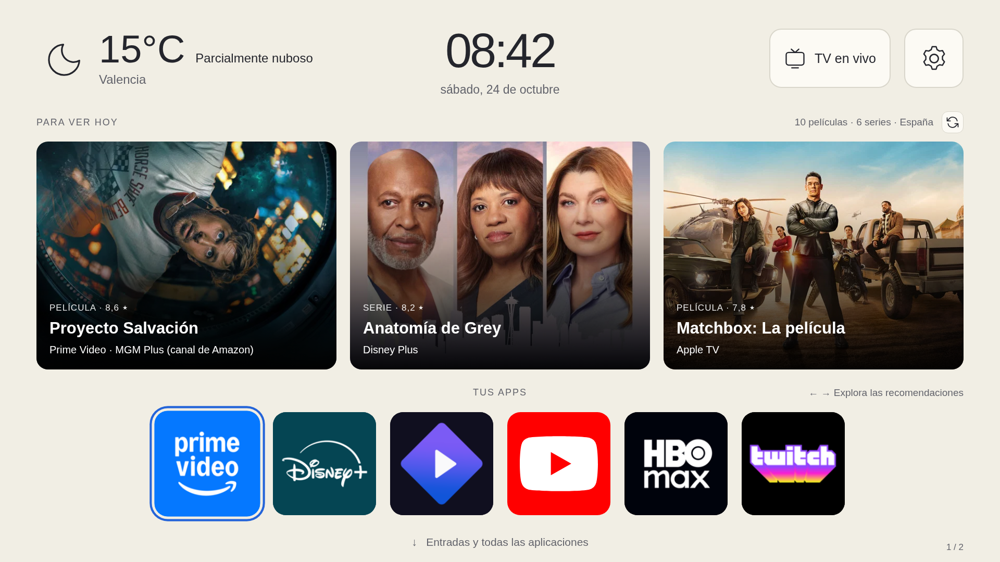
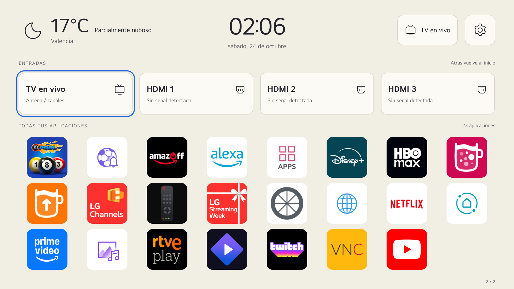
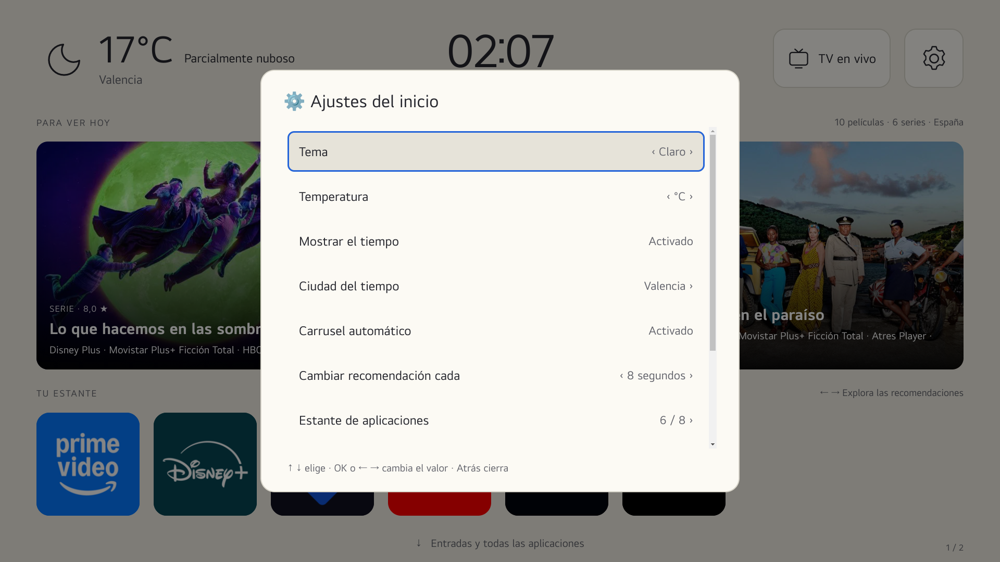
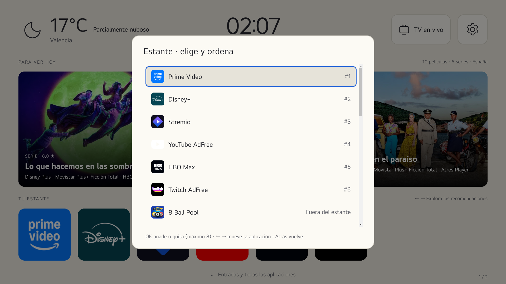

# Inicio LG · webOS

**Un inicio personalizable para tu televisor LG, pensado para manejarlo con el mando.**

Recomendaciones de películas y series, tiempo, aplicaciones favoritas y cambio de entradas, en una interfaz en español y sin efectos de desenfoque costosos.

[](LICENSE)

[](https://github.com/siskomatico/lg_webos/actions/workflows/test.yml)




[Capturas](#capturas) · [Funciones](#funciones) · [Instalación](#instalación) · [Controles](#controles-del-mando) · [Créditos](#créditos-y-licencias)

> Proyecto comunitario no oficial. No es un firmware ni elimina el Home nativo de LG. La compatibilidad está comprobada en un modelo concreto, no en todos los televisores webOS.

## Funciones

| Pantalla | Qué ofrece |
| --- | --- |
| **Inicio** | Tiempo, reloj, TV en vivo, ajustes y un carrusel mixto de **10 películas y 6 series**, con tres tarjetas visibles. |
| **Estante** | Hasta **8 favoritas**, con iconos grandes y orden configurable desde el mando. |
| **Entradas y aplicaciones** | Entradas reales del televisor y todas las aplicaciones visibles instaladas, en una rejilla navegable. |
| **Ajustes** | Tema claro, oscuro o automático; ciudad, °C/°F, rotación y velocidad del carrusel; edición del estante y ajustes de LG. |

- Carrusel automático y navegación manual con ← →. La rotación se pausa mientras lo manejas.
- Plataformas de España en los subtítulos, según los datos de TMDB/JustWatch, sin asignarlas por suposición.
- Caché de recomendaciones y meteorología para reducir consultas repetidas.
- Sin blur/backdrop-filter, sin capas permanentes `will-change` y sin sustituir el salvapantallas de LG.
- Apagado ordenado de webOS, con confirmación independiente y **Cancelar seleccionado inicialmente**. Consulta sus [limitaciones](#apagado-completo-y-seguridad).

## Capturas

Capturas reales de la instalación de referencia. Las apps y los iconos visibles dependen de cada televisor; los iconos extraídos de apps no se distribuyen como assets del repositorio.

### Entradas y todas las aplicaciones



### Ajustes y editor del estante

| Ajustes del inicio | Selección y orden de favoritas |
| --- | --- |
|  |  |

## Compatibilidad y requisitos

| Comprobado | Detalle |
| --- | --- |
| Televisor | LG **55UQ91006LA** |
| Sistema informado | webOS/SDK **7.6.0**, firmware **04.60.90** |
| Interfaz | 1920 × 1080, escalada al área disponible |
| Entradas de referencia | TV en vivo y **3 HDMI**, obtenidos del sistema |

Necesitas:

- Un televisor compatible capaz de instalar aplicaciones webOS.
- **Python 3** para construir el IPK, sin dependencias Python externas.
- Un **token de lectura de TMDB** para las recomendaciones. Open-Meteo no necesita clave.
- **Homebrew Channel con root** para las funciones privilegiadas: enumeración alternativa de apps/entradas y apagado completo. Las llamadas públicas se intentan primero.
- **Node.js 22+ y Playwright**, únicamente para ejecutar las pruebas.

No se incluye un procedimiento de root ni se recomienda modificar firmware o particiones para probar esta interfaz.

## Instalación

### 1. Descargar los fuentes

```sh
git clone https://github.com/siskomatico/lg_webos.git
cd lg_webos
```

### 2. Configurar tu instalación

```sh
cp config.example.json config.local.json
chmod 600 config.local.json
```

Edita `config.local.json`: configura ciudad, coordenadas y `tmdbKey` con tu **token de lectura de TMDB**. No publiques ese archivo.

### 3. Iconos de tu propio televisor — opcional

Para disponer de iconos empaquetados sin depender de que el renderer pueda leer las rutas de otras apps, puedes importarlos por SSH:

```sh
python3 scripts/import_icons.py --host IP_DE_LA_TV --key RUTA_A_TU_CLAVE_SSH
```

También puedes omitir `--key` si utilizas tu agente o configuración SSH. La herramienta lee la lista de apps y sus imágenes; no instala, abre ni elimina aplicaciones ni modifica ajustes del televisor.

Los recursos importados se guardan en `ui/icons/` y `ui/icons.local.json`, **excluidos de Git**. No los redistribuyas sin revisar sus permisos originales. Sin esta importación, se utilizan los iconos que proporcione webOS o nombres como alternativa; no se garantiza la misma apariencia de las capturas.

### 4. Construir el paquete

```sh
python3 scripts/build_custom.py
```

Se genera `dist/org.kagev.inicio_0.2.1_all.ipk`. El ID predeterminado de la app es `org.kagev.inicio`.

Puedes indicar otra configuración privada:

```sh
python3 scripts/build_custom.py --config /ruta/a/configuracion-privada.json
```

> **El IPK y `app/private-config.js` contienen tu token.** Los directorios generados y la configuración privada están ignorados por Git. No adjuntes esos paquetes a una release pública. Este repositorio distribuye fuentes, no credenciales compartidas.

### 5. Instalar en la TV

Utiliza webOS Dev Manager o las herramientas de desarrollo compatibles con tu dispositivo. Con root y permisos adecuados también puede instalarse mediante `com.webos.appInstallService/dev/install`.

La integración con **Home y el arranque** es específica del dispositivo y **no se configura automáticamente**. No se suplantan IDs del sistema ni se desinstala el Home de LG. En algunas transiciones puede aparecer el inicio original mientras carga el launcher.

## Controles del mando

| Control | Acción |
| --- | --- |
| ↑ ↓ ← → | Mover el foco entre controles. |
| OK | Abrir la aplicación, entrada o ajuste seleccionado. |
| ↓ desde el estante | Abrir la segunda pantalla. |
| ← → en el carrusel | Explorar manualmente las recomendaciones. |
| OK en el editor del estante | Añadir o quitar una favorita, hasta ocho. |
| ← → en el editor del estante | Cambiar el orden de la favorita seleccionada. |
| Atrás | Cerrar el diálogo o volver de la segunda pantalla al inicio. |

La selección del estante y las preferencias se guardan en el `localStorage` de la app. No hay una cuenta propia ni sincronización en la nube.

## Datos y limitaciones

- Las recomendaciones se basan en popularidad y disponibilidad en España, no en el historial del usuario.
- Los proveedores no comprueban tus suscripciones, idioma de audio ni acceso gratuito. Puede requerirse suscripción, alquiler o compra.
- Si faltan datos, se indica disponibilidad no confirmada en lugar de inventar una plataforma.
- No hay reproducción directa ni deep-linking de las recomendaciones en esta versión.
- Caché de recomendaciones de seis horas y meteorología de treinta minutos. Si falla la red puede mostrarse información guardada, indicándolo.
- Los nombres y algunos datos de terceros pueden aparecer en su idioma original.
- No se prometen 60 FPS ni mejoras de rendimiento de todas las apps o del firmware.

## Apagado completo y seguridad

Tras confirmar explícitamente, la app solicita `/bin/systemctl --no-block poweroff` mediante el servicio root de Homebrew. No usa apagado forzado ni suspensión, ni cambia el botón de encendido del mando o Quick Start+.

**Es una función privilegiada y dependiente del modelo.** Se verificó la ruta de systemctl en la TV de referencia, pero la primera prueba física de apagado y posterior encendido sigue pendiente. Las pruebas automáticas no deben apagar una TV real. Esta función no equivale a cortar la alimentación eléctrica.

No publiques claves SSH, configuraciones locales, IPK personalizados, exportaciones de `localStorage` ni informes privados del dispositivo.

## Desarrollo y pruebas

```sh
npm ci
npx playwright install chromium
python3 scripts/build_custom.py --config config.example.json
npm test
```

Las pruebas de escritorio usan servicios, credenciales e iconos ficticios. No necesitan una TV ni ejecutan un apagado real. Cubren las dos pantallas, el carrusel, proveedores, caché, navegación, edición/persistencia del estante y confirmación de apagado.

Las capturas e informes de prueba se escriben en `research/`, excluido de Git.

<details>
<summary>Pruebas en un televisor real mediante CDP</summary>

Solo si tu TV ya dispone de depuración accesible, puedes crear un túnel loopback:

```sh
ssh -N -L 127.0.0.1:19998:127.0.0.1:9998 root@IP_DE_LA_TV
npm run test:tv
```

Es una prueba específica del modelo de referencia, con tres HDMI. Bloquea temporalmente la función de apagado, comprueba su cancelación y restaura la función al terminar. No la ejecutes mientras alguien utiliza el mando. No habilita depuración ni abre puertos del televisor.

</details>

### Estructura

```text
ui/                 Interfaz y adaptadores webOS
scripts/            Compilación, empaquetado e importación de iconos
tests/              Pruebas simuladas y del dispositivo de referencia
upstream/           SDK, assets y avisos conservados de la base
docs/images/        Capturas revisadas para el README
config.example.json Configuración de ejemplo sin credenciales
```

## Contribuir

Se agradecen mejoras y resultados de compatibilidad con otros modelos. Al abrir un issue, indica modelo, versión de webOS, pasos para reproducirlo y lo que esperabas que ocurriera. Revisa capturas y registros antes de adjuntarlos para no compartir credenciales o datos personales.

## Créditos y licencias

Este proyecto no parte de cero. Gracias a los autores de:

| Proyecto | Aportación |
| --- | --- |
| [FreeMyTvWebOS · danielthejoker18](https://github.com/danielthejoker18/FreeMyTvWebOS) | Base de empaquetado y componentes conservados. Su aviso MIT se mantiene en [`LICENSE.upstream`](LICENSE.upstream). |
| [Free My TV · simbasjungles](https://github.com/simbasjungles/free-my-tv) | Referencia de diseño, organización y manejo del estante con el mando. |
| [webOSTV.js · LG](https://webostv.developer.lge.com/develop/references/webostvjs-introduction) | SDK 1.2.13 oficial, sin modificar, con su licencia Apache 2.0. |
| [Simple Icons](https://simpleicons.org/) | SVG conservados bajo CC0, con sus avisos y fuentes. |
| [TMDB](https://www.themoviedb.org/) y [JustWatch](https://www.justwatch.com/) | Metadatos, imágenes y disponibilidad por plataforma. |
| [Open-Meteo](https://open-meteo.com/) | Datos meteorológicos. |

**Nuestro código y modificaciones se publican bajo [MIT](LICENSE): puedes utilizarlos, modificarlos y compartirlos manteniendo los avisos correspondientes.** Los componentes de otros autores conservan sus licencias, y MIT no concede derechos sobre sus marcas, carátulas o contenido.

Consulta [`NOTICES.md`](NOTICES.md) y [`upstream/README.md`](upstream/README.md) para la procedencia y condiciones de los componentes conservados.

Este producto utiliza la API de TMDB, pero no está avalado ni certificado por TMDB. Proyecto sin afiliación con LG ni con las plataformas mostradas. No incluye firmware ni un mecanismo de recuperación de televisores.
