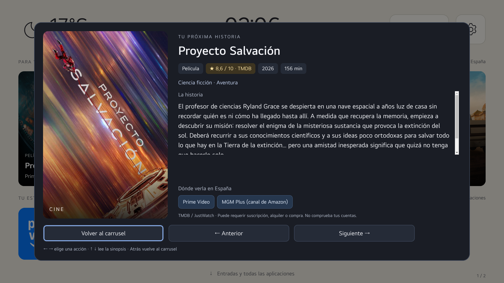
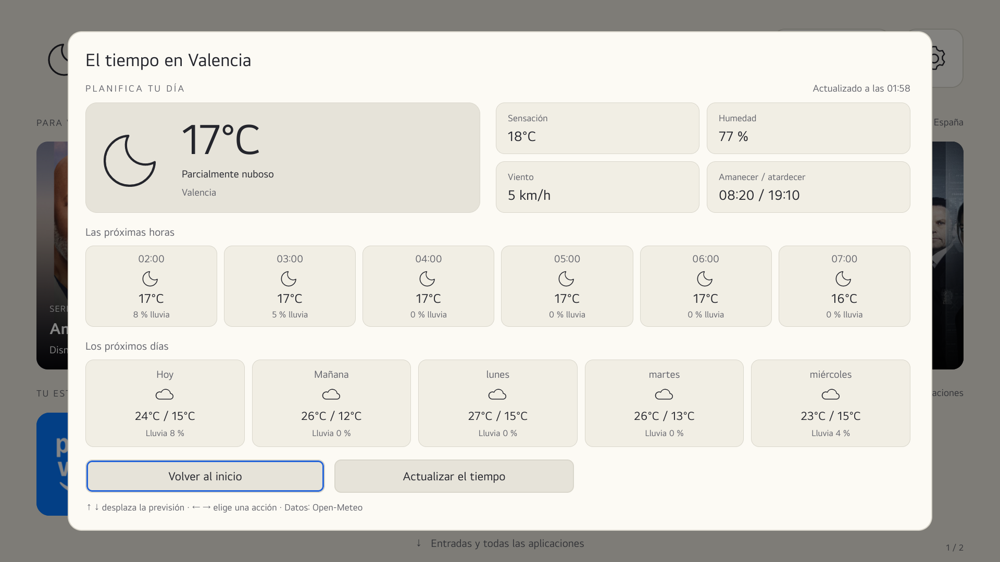

# Inicio LG · webOS

**Un inicio personalizable para tu televisor LG, pensado para manejarlo con el mando.**

Películas y series, tiempo, aplicaciones favoritas y entradas. Interfaz en español, con fichas de contenido y previsión meteorológica, sin efectos de desenfoque costosos.

[](LICENSE)

[](https://github.com/siskomatico/lg_webos/actions/workflows/test.yml)


[Capturas](#capturas) · [Instalar sin root](#instalación-sin-root) · [Instalar con root](#instalación-con-root) · [Diferencias](#qué-cambia-con-y-sin-root) · [Controles](#controles-del-mando) · [Créditos](#créditos-y-licencias)

> Proyecto comunitario no oficial. No es un firmware, no elimina el Home nativo y no modifica particiones. La compatibilidad no se garantiza para todos los televisores webOS.

## Novedades de v0.3.0

- **Recomendaciones con ficha cinematográfica:** carátula grande, puntuación, año, duración o temporadas, géneros, sinopsis desplazable, reparto y plataformas de España. Títulos anterior/siguiente sin cerrar la ficha. La información adicional se solicita al abrir y se guarda durante 24 horas.
- **Tiempo con previsión completa:** temperatura y estado actual, sensación térmica, humedad, viento, amanecer/atardecer, seis próximas horas y cinco días con máximas, mínimas y probabilidad de lluvia. Respeta °C/°F e indica cuándo utiliza datos guardados.
- **Modo sin root explícito:** no realiza ninguna llamada a Homebrew, bloquea el apagado privilegiado y permite un catálogo manual si webOS deniega la lista de aplicaciones.
- Mejor restauración del foco al cerrar las fichas y navegación con el mando.

## Funciones

| Pantalla | Qué ofrece |
| --- | --- |
| **Inicio** | Tiempo, reloj, TV en vivo, ajustes y carrusel de **10 películas + 6 series**, con tres tarjetas visibles. |
| **Fichas** | Carátula, metadatos, sinopsis y proveedores de España según TMDB/JustWatch; no asignados por suposición. |
| **Tiempo** | Panel de condiciones actuales, próximas horas y previsión de cinco días. |
| **Estante** | Hasta **8 favoritas**, con iconos grandes y orden configurable desde el mando. |
| **Entradas y apps** | Entradas y rejilla navegable; detección automática o accesos manuales según permisos. |
| **Ajustes** | Tema claro/oscuro/automático, ciudad, unidades, carrusel y edición del estante. |

El carrusel se pausa mientras interactúas. Hay caché de datos y el trabajo periódico se pausa en segundo plano. No se utiliza blur/backdrop-filter ni se sustituye el salvapantallas de LG.

## Capturas

Capturas reales del televisor de referencia. Las apps y sus iconos dependen de cada instalación; los iconos extraídos del televisor no se distribuyen como assets.

### Nuevas vistas de detalle





### Entradas y aplicaciones


| Ajustes | Editor del estante |
| --- | --- |
|  |  |

## Compatibilidad y requisitos

- **Referencia real:** LG **55UQ91006LA**, webOS/SDK **7.6.0**, firmware **04.60.90**, TV en vivo y tres HDMI.
- Interfaz diseñada a 1920 × 1080 y escalada al área disponible.
- **Python 3**, sin dependencias Python externas, para construir el IPK.
- Un **token de lectura de TMDB** propio para recomendaciones y fichas. Open-Meteo no requiere clave.
- **Node.js 22+ y Playwright**, solo para las pruebas de desarrollo.
- Instalación sin root mediante Developer Mode, o con root ya existente mediante herramientas compatibles.

**No se ha probado una instalación física en una TV sin root.** Sí se ha probado el modo no privilegiado con denegaciones simuladas y se han consultado las API públicas desde una app normal en la TV de referencia, sin utilizar Homebrew para esas consultas. Esto no demuestra compatibilidad con todos los firmwares.

## Qué cambia con y sin root

La interfaz no necesita root. Los permisos para consultar o controlar webOS son una cuestión distinta de cómo se instala el IPK.

| Función | Sin root | Con root + Homebrew |
| --- | --- | --- |
| Interfaz, tiempo, recomendaciones, fichas y preferencias | Sí | Sí |
| Estante y accesos a aplicaciones | Sí; catálogo manual si el sistema bloquea la lista | Detección automática con alternativa privilegiada |
| Abrir apps, TV en vivo, HDMI y ajustes de LG | Llamada pública; depende del firmware y del ID | Comprobado en el modelo de referencia |
| Detectar nombres y estado real de HDMI | Si la API pública lo permite; si no, accesos manuales sin estado inventado | API pública o alternativa privilegiada |
| Apagado completo mediante systemctl | **No**; control deshabilitado | Con confirmación; prueba física pendiente |
| Reasignar Home / arrancar automáticamente | **No lo configura esta app**; abrir desde LG o un acceso rápido | Posible mediante integración externa y reversible; no automática |
| Permanencia de la instalación | Depende de mantener activa la sesión Developer Mode | No depende de Developer Mode si se instala por el método root |

En la referencia, `launch` y `getAllInputStatus` funcionaron sin pasar por el servicio privilegiado. `listLaunchPoints`, `listApps` y `getAppInfo` fueron **denegados** a la app. Por eso no se promete enumeración automática sin root. El catálogo manual evita que ese bloqueo inutilice el estante.

## Instalación sin root

### 1. Preparar Developer Mode

1. Sigue la [guía oficial de LG](https://webostv.developer.lge.com/develop/getting-started/developer-mode-app): cuenta de desarrollador, aplicación **Developer Mode** en la TV y activación de **Dev Mode Status**.
2. Tras el reinicio indicado por LG, activa **Key Server** y conecta la TV desde [webOS Dev Manager](https://github.com/webosbrew/dev-manager-desktop). Utiliza la IP y la passphrase que muestra la TV. No publiques esos datos.
3. Comprueba periódicamente el tiempo restante y **extiende la sesión antes de que caduque**. LG indica que desactivar/caducar Developer Mode puede desinstalar las apps instaladas por este método. No hay bypass de esta condición en Inicio LG.

> Si tu TV ya tiene root, no instales ni actives Developer Mode como parte de esta guía. Utiliza la sección con root y las indicaciones del método con el que rooteaste tu TV.

### 2. Configurar y compilar

```sh
git clone https://github.com/siskomatico/lg_webos.git
cd lg_webos
cp config.noroot.example.json config.local.json
chmod 600 config.local.json
# Edita ciudad, coordenadas, tmdbKey y tus accesos.
python3 scripts/build_custom.py --mode noroot
```

Se genera **`dist/noroot/org.kagev.inicio_0.3.0_all.ipk`**.

El ejemplo incluye accesos conocidos a Netflix, Prime Video, Disney+ y YouTube. **Adáptalos a las apps que tengas realmente instaladas.** Si la lista del sistema está bloqueada, no se comprueba su instalación; se muestran como «accesos configurados», no como inventario detectado.

```json
"apps": [
  {"id": "netflix", "title": "Netflix", "color": "#171717"},
  {"id": "amazon", "title": "Prime Video", "color": "#182738"}
],
"inputs": [
  {"id": "com.webos.app.hdmi1", "title": "Consola"},
  {"id": "com.webos.app.hdmi2", "title": "Ordenador"}
]
```

`inputs` solo se utiliza cuando no se puede consultar el sistema. Ajusta sus entradas al número de puertos de tu modelo; su señal aparecerá como **sin confirmar**. Puedes añadir iconos propios o autorizados a tus accesos; sin imágenes legibles se muestran sus nombres.

### 3. Instalar y abrir

En **webOS Dev Manager**, selecciona tu dispositivo, pulsa **Install** y elige el IPK de `dist/noroot/`. También puedes usar `ares-install` si ya tienes configurada la CLI oficial:

```sh
ares-install --device mi-tv dist/noroot/org.kagev.inicio_0.3.0_all.ipk
```

Abre **Inicio LG** desde el menú de LG. Si tu modelo lo permite, asígnalo al acceso rápido de una tecla numérica. Este modo **no intercepta Home ni instala scripts de arranque** y nunca llama al servicio root de Homebrew.

## Instalación con root

### 1. Requisitos del televisor

TV con root ya obtenido y **Homebrew Channel con root activado**. No se incluye un procedimiento para rootear ni se recomienda flashear firmware para instalar este launcher. Conserva una copia de tu integración anterior antes de cambiarla.

### 2. Configurar y compilar

```sh
git clone https://github.com/siskomatico/lg_webos.git
cd lg_webos
cp config.example.json config.local.json
chmod 600 config.local.json
# Edita ciudad, coordenadas y tmdbKey.
python3 scripts/build_custom.py --mode root
```

Se genera **`dist/root/org.kagev.inicio_0.3.0_all.ipk`**. Las llamadas públicas se intentan primero; Homebrew se utiliza para las alternativas de lectura que lo necesitan y para el apagado confirmado.

### 3. Iconos del televisor — opcional

```sh
python3 scripts/import_icons.py --host IP_DE_LA_TV --key RUTA_A_TU_CLAVE_SSH
python3 scripts/build_custom.py --mode root
```

La herramienta lee las imágenes por SSH, sin abrir/desinstalar apps ni modificar ajustes. Puedes omitir `--key` si utilizas un agente o configuración SSH. Los archivos se guardan en `ui/icons/` y `ui/icons.local.json`, **excluidos de Git**. No los redistribuyas sin revisar sus permisos originales.

### 4. Instalar e integrar

Instala el IPK con **webOS Dev Manager configurado para tu conexión root**, o mediante el instalador webOS compatible con tu método de root (`com.webos.appInstallService/dev/install`). No es necesario activar Developer Mode.

El ID sigue siendo **`org.kagev.inicio`**. Si ya tienes Home/arranque redirigidos a ese ID, no debes cambiarlos para actualizar. La integración es externa y específica de cada dispositivo: **el instalador no reasigna teclas ni modifica el arranque**. No se elimina ni suplanta el Home de LG; puede aparecer brevemente en algunas transiciones.

### Configuración y paquetes privados — ambos métodos

Puedes utilizar `--config /ruta/a/configuracion.json`. Ambos modos tienen el mismo ID: instalar uno sustituye al otro; no son apps independientes.

> **Los IPK y `app/private-config.js` contienen tu token.** No subas los paquetes personalizados a GitHub, aunque el código tenga licencia MIT. La configuración, las imágenes importadas y los directorios generados están ignorados por Git. Este repositorio distribuye fuentes, no credenciales compartidas.

## Controles del mando

| Control | Acción |
| --- | --- |
| ↑ ↓ ← → | Mover el foco. |
| OK | Abrir el elemento o ejecutar la acción seleccionada. |
| ↓ desde el estante | Abrir entradas y aplicaciones. |
| ← → en el carrusel | Explorar recomendaciones. |
| ↑ ↓ en una ficha | Desplazar la sinopsis o previsión. |
| ← → en una ficha | Elegir Volver / Anterior / Siguiente, o actualizar el tiempo. |
| OK en el editor del estante | Añadir/quitar una favorita, hasta ocho. |
| ← → en el editor | Cambiar el orden de la favorita. |
| Atrás | Cerrar el diálogo y recuperar el foco, o volver de la segunda pantalla. |

Las preferencias se guardan en `localStorage`. No hay cuenta propia ni sincronización en la nube.

## Datos, límites y seguridad

- Recomendaciones basadas en popularidad y disponibilidad en España, no en tu historial.
- Las plataformas no verifican tus suscripciones, idiomas ni acceso gratuito. Se distinguen los datos sin confirmar y las ofertas de alquiler/compra.
- **No hay reproducción directa ni deep-linking** de recomendaciones.
- Caché: recomendaciones seis horas, fichas 24 horas, tiempo 30 minutos. Si falla la red se indica cuando se usan datos guardados. No se inventan valores meteorológicos ausentes.
- Algunos nombres de terceros pueden estar en su idioma original.
- No se prometen 60 FPS ni mejoras del firmware o del rendimiento de otras apps.

### Apagado completo

Solo en modo root, y tras confirmar con **Cancelar seleccionado inicialmente**, se solicita `/bin/systemctl --no-block poweroff` mediante Homebrew. No hay apagado forzado, suspensión ni cambios del mando o Quick Start+.

La ruta de systemctl se comprobó en la TV de referencia, pero la **primera prueba física de apagado y posterior encendido sigue pendiente**. No equivale a cortar la alimentación. Las pruebas automáticas no apagan una TV real.

Nunca publiques claves SSH, configuraciones privadas, IPK personalizados, exportaciones de `localStorage` ni informes privados.

## Desarrollo y pruebas

```sh
npm ci
npx playwright install chromium
python3 -m unittest discover -s tests -p 'test_*.py'
python3 scripts/build_custom.py --mode root --config config.example.json
npm test
python3 scripts/build_custom.py --mode noroot --config config.noroot.example.json
npm test
```

Las pruebas usan servicios, credenciales e imágenes ficticios. Sirven la app por HTTP solo en loopback, **sin servir tu configuración privada**. Cubren fichas, metadatos bajo demanda/caché, foco, previsión, °C/°F, datos guardados, las dos pantallas, carrusel, estante, permisos denegados, catálogo manual y ausencia de llamadas privilegiadas en modo sin root. El apagado confirmado se prueba únicamente con un servicio simulado.

GitHub Actions compila y prueba ambos modos. Capturas e informes de diagnóstico van a `research/`, excluido de Git.

<details>
<summary>Pruebas opcionales en TV mediante CDP</summary>

Solo si tu televisor ya dispone de depuración accesible, crea un túnel loopback:

```sh
ssh -N -L 127.0.0.1:19998:127.0.0.1:9998 root@IP_DE_LA_TV
npm run test:tv
node tests/tv-details.cjs
```

Son pruebas específicas del modelo de referencia, con tres HDMI. Abren pantallas y pueden interferir con el uso del mando: no las ejecutes mientras alguien ve la TV. Guardan la función de apagado, la bloquean durante la prueba y la restauran al terminar. No habilitan depuración ni abren puertos externos.

</details>

### Estructura

```text
ui/                         Interfaz, fichas y adaptadores webOS
scripts/                    Compilación, empaquetado e importación de iconos
tests/                      Pruebas simuladas y del dispositivo de referencia
upstream/                   SDK, assets y avisos de la base
docs/images/                Capturas revisadas para el README
config.example.json         Ejemplo sin credenciales, modo root
config.noroot.example.json  Ejemplo con catálogo manual, modo sin root
```

## Contribuir

Se agradecen mejoras y pruebas de compatibilidad. Al abrir un issue indica modelo, webOS, modo root/sin root, pasos y resultado esperado. Revisa registros y capturas para no compartir credenciales ni datos privados.

## Créditos y licencias

Este proyecto no parte de cero. Gracias a:

| Proyecto | Aportación |
| --- | --- |
| [FreeMyTvWebOS · danielthejoker18](https://github.com/danielthejoker18/FreeMyTvWebOS) | Base de empaquetado y componentes conservados. Su aviso MIT se mantiene en [`LICENSE.upstream`](LICENSE.upstream). |
| [Free My TV · simbasjungles](https://github.com/simbasjungles/free-my-tv) | Referencia de diseño, organización y manejo del estante. |
| [webOSTV.js · LG](https://webostv.developer.lge.com/develop/references/webostvjs-introduction) | SDK oficial 1.2.13, sin modificar, bajo Apache 2.0. |
| [Simple Icons](https://simpleicons.org/) | SVG conservados bajo CC0, con sus fuentes y avisos. |
| [TMDB](https://www.themoviedb.org/) / [JustWatch](https://www.justwatch.com/) | Metadatos, imágenes y disponibilidad de películas y series. |
| [Open-Meteo](https://open-meteo.com/) | Meteorología. |

**Nuestro código y modificaciones se publican bajo [MIT](LICENSE): puedes utilizarlos, modificarlos y compartirlos conservando los avisos.** Los componentes de terceros mantienen sus licencias. MIT no concede derechos sobre sus marcas, carátulas o contenido.

Consulta [`NOTICES.md`](NOTICES.md) y [`upstream/README.md`](upstream/README.md) para la procedencia y condiciones de los componentes conservados.

Este producto utiliza la API de TMDB, pero no está avalado ni certificado por TMDB. Sin afiliación con LG ni con las plataformas mostradas. No incluye firmware ni un mecanismo de recuperación del televisor.
